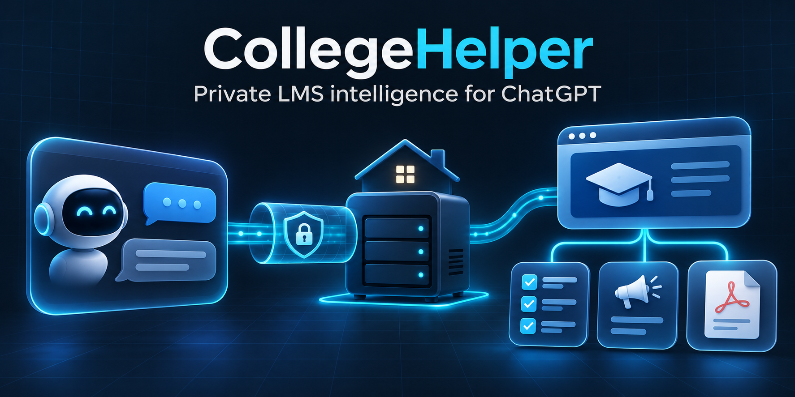
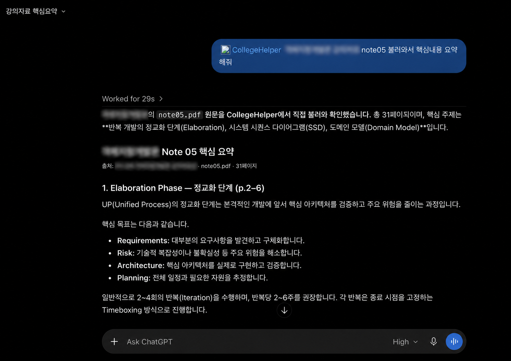
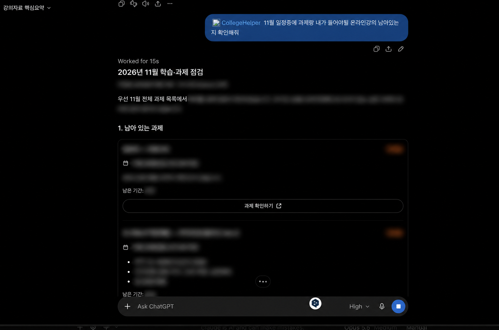
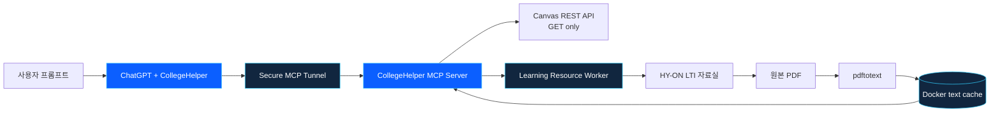

<p align="center">
  
</p>

<h1 align="center">CollegeHelper</h1>

<p align="center">
  ChatGPT에서 과제, 공지, 강의자료를 바로 조회하고 학습할 수 있도록 만든<br />
  <strong>개인용 Canvas LMS MCP 플러그인</strong>
</p>

<p align="center">
  
  
  
  
  
</p>

## 프로젝트 소개

대학 LMS에는 과제, 공지, 주차학습과 강의자료가 흩어져 있습니다. 필요한 정보를 확인하려면 매번 LMS에 접속해야 하고, 강의자료를 AI와 함께 공부하려면 파일을 채팅마다 다시 첨부해야 합니다.

CollegeHelper는 이 과정을 하나의 자연어 요청으로 연결합니다. ChatGPT가 홈서버의 MCP 도구를 호출하면 서버가 HY-ON(Canvas LMS)의 최신 데이터를 읽고, 필요한 근거만 정규화해 반환합니다. 강의자료실 PDF는 최초 요청 시 텍스트로 추출하여 영구 캐시하므로 이후 채팅에서도 다시 업로드할 필요가 없습니다.

```text
@CollegeHelper 객체지향개발론의 note05를 불러와서 핵심 내용을 요약해줘.
@CollegeHelper 앞으로 7일 동안 마감되는 미제출 과제를 우선순위대로 정리해줘.
@CollegeHelper 최근 공지 중에서 내가 확인해야 할 내용만 알려줘.
```

> 이 프로젝트는 개인 사용을 위한 비공개 플러그인입니다. Canvas 쓰기 작업, 과제 제출, 성적 조회 및 다중 사용자 기능은 제공하지 않습니다.

## 핵심 기능

| 기능 | 설명 |
|---|---|
| 과목·과제 조회 | 현재 수강 과목, 마감일과 본인 제출 상태를 실시간으로 조회합니다. |
| 공지·모듈 조회 | 최근 공지와 과목별 주차학습 구조를 필요한 필드만 정규화합니다. |
| 강의자료 자동 수집 | Canvas 외부 LTI 강의자료실에서 사용자가 열람 가능한 PDF를 읽기 전용으로 가져옵니다. |
| PDF 텍스트 캐시 | 원본 PDF를 텍스트화한 뒤 Docker 볼륨에 저장해 다음 채팅과 컨테이너 재시작에서도 재사용합니다. |
| ChatGPT MCP 연동 | OpenAI Secure MCP Tunnel을 통해 공개 인바운드 포트 없이 홈서버 도구를 호출합니다. |
| 방어적 보안 | Canvas GET 전용, 비인가 POST 차단, 토큰·원본 응답·PDF 비저장을 기본값으로 사용합니다. |

## 구동 예시

### 강의자료를 직접 불러와 학습

CollegeHelper가 강의자료실의 원본 PDF를 가져와 텍스트를 추출하고, ChatGPT가 실제 강의 내용을 근거로 핵심 개념을 정리합니다.



### 과제와 학습 일정 점검

Canvas 과제와 본인 제출 상태를 조회하여 남은 일정과 확인할 항목을 한 번에 정리합니다.



> 공개 이미지에는 실제 과목명, 과제명, 마감일, 제출 상태와 세부 내용을 블러 처리했습니다.

## 시스템 구조



MCP 서버는 공개 주소를 직접 열지 않고 Secure MCP Tunnel에 연결됩니다. Canvas API 데이터는 서비스 계층에서 정규화하며, 외부 LTI 자료실만 격리된 Playwright 워커가 처리합니다. 자세한 흐름은 [아키텍처 문서](./docs/ARCHITECTURE.md)를 참고하세요.

## 구현 과정에서 해결한 문제

### 1. API가 존재하는 것과 실제로 사용할 수 있는 것은 달랐습니다

Canvas 공식 문서의 엔드포인트를 곧바로 도구로 만들지 않고, 개인 토큰으로 비식별 API 감사를 수행했습니다. 실제 HY-ON 환경에서 `supported`로 확인된 데이터만 MCP 도구로 노출했습니다.

### 2. 강의자료실은 Canvas Files API가 아니었습니다

강의자료실은 별도의 LTI 외부 학습도구였습니다. Canvas의 공식 `tabs`와 `sessionless_launch` GET 경로로 진입한 뒤, 브라우저 네트워크 감사를 통해 자료 목록과 `original.pdf` 읽기 경로를 확인했습니다.

### 3. 채팅마다 PDF를 다시 첨부하면 학습 흐름이 끊겼습니다

최초 요청에서만 PDF를 내려받고 `pdftotext`로 변환합니다. 원본 파일은 즉시 삭제하고 추출 텍스트만 Docker 볼륨에 저장하여 세션과 컨테이너가 바뀌어도 재사용하도록 설계했습니다.

### 4. LMS 자동화가 사용자 상태를 바꾸면 안 됐습니다

Canvas API는 GET 요청만 허용하고 모든 MCP 도구에 읽기 전용 힌트를 지정했습니다. LTI 로그인 핸드셰이크 외의 비-GET 네트워크 요청은 워커에서 차단하여 진도율이나 완료 상태가 바뀌지 않도록 했습니다.

## 검증 결과

개발 환경에서 다음 동작을 확인했습니다. 실제 응답 본문과 사용자 데이터는 테스트 fixture나 Git 이력에 저장하지 않았습니다.

| 검증 항목 | 결과 |
|---|---:|
| 제공 MCP 도구 | 9개 |
| 실제 과목 강의자료 목록 | 11개 조회 |
| `note05.pdf` 추출 텍스트 | 24,230자 |
| 캐시 재호출 | 약 4ms 관측 |
| 컨테이너 재시작 후 캐시 | 유지 확인 |
| 자동화 테스트 | 9개 파일, 20개 테스트 |

## 제공 도구

| MCP 도구 | 용도 |
|---|---|
| `list_courses` | 현재 수강 과목 조회 |
| `get_today_tasks` | 지정 날짜의 과제와 제출 상태 조회 |
| `get_upcoming_tasks` | 최대 31일 범위의 예정 과제 조회 |
| `get_announcements` | 최근 과목 공지 조회 |
| `get_course_modules` | 과목별 학습 모듈 조회 |
| `get_course_module_items` | 모듈별 과제·외부 학습자료 항목 조회 |
| `get_assignment_context` | 과제 설명, 마감일과 제출 상태 조회 |
| `list_course_learning_resources` | LTI 강의자료 목록과 캐시 상태 조회 |
| `get_learning_resource_text` | PDF 원문 자동 수집 및 텍스트 구간 조회 |

모든 도구는 읽기 전용이며 외부에서 가져온 본문은 신뢰되지 않은 콘텐츠로 표시합니다.

## 기술 스택

- **Runtime:** Node.js 22, TypeScript
- **Protocol:** Model Context Protocol, Streamable HTTP
- **Validation:** Zod
- **Browser worker:** Playwright, Chromium
- **Document extraction:** Poppler `pdftotext`
- **Test:** Vitest, ESLint, TypeScript type checking
- **Deployment:** Docker Compose, systemd user service
- **Connection:** OpenAI Secure MCP Tunnel

## 빠른 시작

### 1. 로컬 설정

```bash
npm install
cp .env.example .env
./scripts/configure-env.sh
```

토큰은 보안 입력 스크립트로 로컬 `.env`에만 저장합니다. 토큰을 채팅, 이슈, 커밋 또는 테스트 fixture에 입력하지 마세요.

### 2. 검증 및 개발 서버

```bash
npm run check
npm run build
npm run dev
```

기본 MCP 엔드포인트는 `http://127.0.0.1:3000/mcp`, 상태 확인 주소는 `http://127.0.0.1:3000/healthz`입니다.

### 3. Docker 실행

```bash
docker compose up -d --build college-helper
curl http://127.0.0.1:3100/healthz
npm run smoke:mcp
```

호스트에는 루프백 포트만 공개됩니다. 강의자료 텍스트는 Git 저장소가 아닌 `learning-resource-cache` Docker 볼륨에 저장됩니다.

### 4. Secure MCP Tunnel 설정

Platform에서 생성한 Runtime API key는 다음 스크립트로 홈서버에 안전하게 입력합니다.

```bash
./scripts/configure-openai-tunnel.sh
```

터널 서비스 설치와 홈서버 운영 절차는 [플러그인 사용 흐름](./docs/CHATGPT_PLUGIN_UX.md)과 [아키텍처 문서](./docs/ARCHITECTURE.md)를 참고하세요.

## 보안과 개인정보 보호

- Canvas 토큰은 홈서버 환경변수에서만 읽습니다.
- 토큰, Authorization 헤더와 원본 API 응답은 로그에 기록하지 않습니다.
- Canvas API 요청은 설정된 호스트의 `/api/v1/` GET 경로로 제한합니다.
- 원본 PDF는 텍스트 추출 직후 삭제합니다.
- 성적, 점수, 이메일과 로그인 ID는 MCP 응답에서 제외합니다.
- 실제 사용자 응답은 테스트, 스냅샷, 보고서와 Git 이력에 저장하지 않습니다.

자세한 위협 모델과 방어선은 [보안 문서](./docs/SECURITY.md)를 참고하세요.

## 현재 범위와 로드맵

현재 구현은 API 감사, 읽기 전용 Canvas 서비스, MCP 서버, LTI 강의자료 수집과 영구 캐시까지 포함합니다.

- [x] Canvas API 비식별 감사
- [x] 과목·과제·제출 상태·공지·모듈 조회
- [x] ChatGPT 비공개 MCP 플러그인 연결
- [x] LTI 강의자료 목록 및 PDF 원문 추출
- [x] 재시작에도 유지되는 텍스트 캐시
- [ ] 변경된 강의자료의 캐시 갱신 정책
- [ ] 예약 작업 기반 일일 학습 브리핑 고도화
- [ ] PDF 외 문서 형식 지원 검토

다중 사용자, Canvas 쓰기 작업, 과제 자동 제출과 성적 조회는 의도적으로 범위에서 제외합니다.

## 문서

- [개발 제안서](./CollegeHelper_개발_제안서.md)
- [시스템 아키텍처](./docs/ARCHITECTURE.md)
- [보안 설계](./docs/SECURITY.md)
- [ChatGPT 플러그인 사용 흐름](./docs/CHATGPT_PLUGIN_UX.md)
