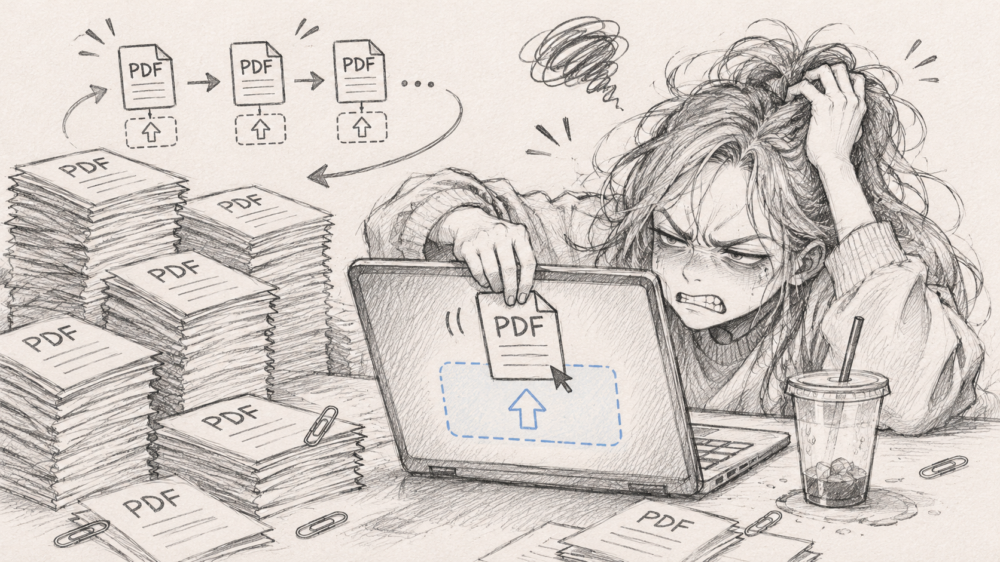
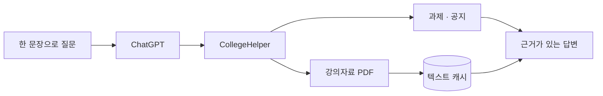

<p align="center">
  
</p>

<h1 align="center">CollegeHelper</h1>

<p align="center">
  <strong>PDF를 또 올리기 싫어서, LMS를 ChatGPT에 연결했습니다.</strong><br />
  과제 확인부터 강의자료 공부까지 한 문장으로 시작하는 개인용 Canvas MCP 플러그인
</p>

<p align="center">
  
  
  
  
  
</p>

## PDF를 또 올려야 하나요?

강의자료를 질문하려면 PDF를 내려받아 채팅에 넣고, 새 채팅을 열면 또 넣어야 했습니다. 과제와 공지를 확인하려면 LMS 탭도 다시 열어야 했습니다.



그래서 **LMS에서 자료를 찾는 일 자체를 ChatGPT에 맡기기로 했습니다.**

```text
@CollegeHelper 객체지향개발론의 note05를 불러와서 핵심 내용만 정리해줘.
@CollegeHelper 앞으로 7일 동안 남은 미제출 과제를 알려줘.
@CollegeHelper 최근 공지 중에서 내가 확인할 것만 골라줘.
```

CollegeHelper가 과제와 공지를 바로 확인하고, 필요한 강의 PDF를 직접 가져옵니다. 한 번 읽은 자료는 홈서버에 텍스트로 보관하므로 다음 채팅에서는 다시 첨부하지 않아도 됩니다.

## 할 수 있는 일

| 물어보면 | CollegeHelper가 하는 일 |
|---|---|
| “이번 주에 뭐 내야 해?” | 과제 마감일과 내 제출 상태를 함께 확인합니다. |
| “새 공지 있어?” | 최근 공지에서 확인할 내용만 가져옵니다. |
| “이 과목 자료 목록 보여줘.” | LMS 강의자료실의 PDF 목록을 찾습니다. |
| “note05로 시험 공부하자.” | PDF를 직접 읽고 필요한 구간을 ChatGPT에 전달합니다. |
| “다음 채팅에서도 다시 읽어줘.” | 이미 처리한 자료는 영구 캐시에서 바로 불러옵니다. |

모든 기능은 읽기 전용입니다. 과제를 제출하거나 진도 상태, 성적과 LMS 데이터를 변경하지 않습니다.

## 실제 사용 모습

### 강의자료를 직접 불러와 학습

파일을 첨부하지 않아도 CollegeHelper가 원본 PDF를 찾고, ChatGPT가 실제 강의 내용을 바탕으로 설명합니다.


### 과제와 학습 일정 점검

과제 목록과 내 제출 상태를 함께 확인하여 남은 일정을 정리합니다.


> 공개 이미지에는 실제 과목명, 과제명, 마감일, 제출 상태와 세부 내용을 블러 처리했습니다.

## 어떻게 이어지나요?



ChatGPT는 Secure MCP Tunnel을 통해 홈서버의 CollegeHelper를 호출합니다. Canvas 정보는 공식 API로 읽고, 별도 LTI 강의자료실은 격리된 Playwright 워커가 처리합니다.

## 직접 확인한 결과

| 항목 | 결과 |
|---|---:|
| 제공 MCP 도구 | 9개 |
| 실제 과목 강의자료 | 11개 조회 |
| `note05.pdf` 추출 텍스트 | 24,230자 |
| 캐시 재호출 | 약 4ms 관측 |
| 컨테이너 재시작 후 캐시 | 유지 확인 |
| 자동화 테스트 | 9개 파일, 20개 테스트 |

실제 LMS 응답 본문과 사용자 데이터는 테스트 fixture, 로그와 Git 이력에 저장하지 않았습니다.

## 구현에서 중요했던 것

- 문서에 존재하는 API가 아니라 **실제 HY-ON에서 확인된 API만** 도구로 만들었습니다.
- Canvas 기본 파일 기능이 아닌 **외부 LTI 강의자료실의 읽기 경로**를 별도로 조사했습니다.
- 원본 PDF는 텍스트 추출 후 삭제하고, 재사용할 텍스트만 Docker 볼륨에 저장합니다.
- Canvas 요청은 GET으로 제한하고, LTI 로그인 외의 비-GET 요청은 워커에서 차단합니다.
- MCP 포트는 외부에 열지 않고 Secure MCP Tunnel로 연결합니다.

자세한 설치 방법, MCP 도구 목록과 구현 과정은 [구현 문서](./docs/IMPLEMENTATION.md)에 분리했습니다.

## 문서

- [구현 및 실행 가이드](./docs/IMPLEMENTATION.md)
- [시스템 아키텍처](./docs/ARCHITECTURE.md)
- [보안 설계](./docs/SECURITY.md)
- [ChatGPT 플러그인 사용 흐름](./docs/CHATGPT_PLUGIN_UX.md)
- [초기 개발 제안서](./CollegeHelper_개발_제안서.md)

> CollegeHelper는 개인 사용을 위한 비공개 플러그인입니다. 다중 사용자, Canvas 쓰기 작업, 과제 자동 제출과 성적 조회는 의도적으로 지원하지 않습니다.
