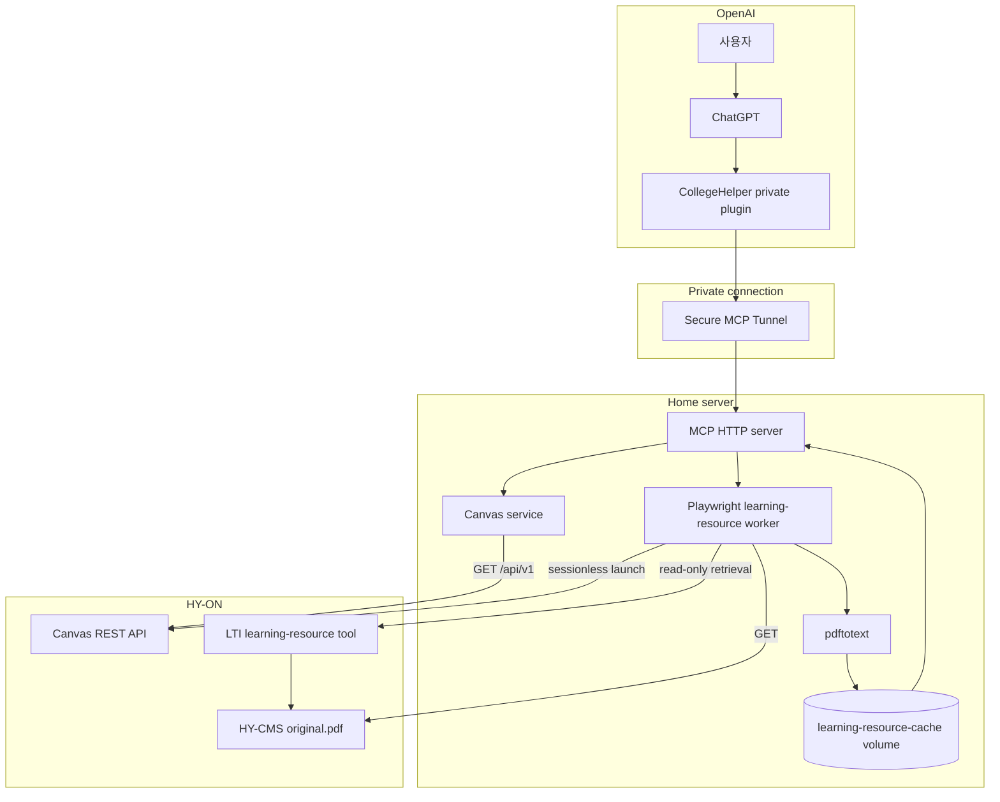

# CollegeHelper 아키텍처

## 설계 목표

CollegeHelper는 사용자가 열람할 수 있는 LMS 정보를 ChatGPT에 안전하게 제공하는 개인용 읽기 전용 MCP 서버입니다. 서버는 자연어 답변을 직접 생성하지 않고, 과목·마감일·제출 상태·공지·강의자료 텍스트와 같은 근거 데이터를 구조화해 반환합니다.

핵심 설계 목표는 다음과 같습니다.

1. Canvas 공식 API를 우선 사용합니다.
2. 실제 HY-ON 감사에서 확인된 데이터만 도구로 제공합니다.
3. Canvas 상태를 변경하지 않습니다.
4. 토큰과 실제 사용자 응답을 영구 저장하지 않습니다.
5. 같은 강의자료는 세션이 달라져도 다시 내려받지 않습니다.

## 전체 구성

## 요청 흐름

### Canvas 데이터

1. ChatGPT가 사용자 요청에 맞는 MCP 도구를 선택합니다.
2. MCP 서버가 Zod 스키마로 입력을 검증합니다.
3. Canvas 서비스가 허용된 `/api/v1/` GET 요청을 수행합니다.
4. 페이지네이션을 따라 필요한 목록을 모두 수집합니다.
5. 성적·이메일·로그인 ID 등 불필요한 필드를 제거합니다.
6. 구조화 데이터와 원문 링크를 MCP 응답으로 반환합니다.

### 강의자료 원문

1. `list_course_learning_resources`가 과목의 강의자료와 캐시 상태를 반환합니다.
2. ChatGPT가 선택한 `resourceId`로 `get_learning_resource_text`를 호출합니다.
3. 캐시가 있으면 저장된 텍스트를 즉시 반환합니다.
4. 캐시가 없으면 워커가 Canvas의 공식 sessionless launch로 LTI 자료실에 진입합니다.
5. 사용자가 열람할 수 있는 `original.pdf`를 임시 디렉터리에 내려받습니다.
6. `pdftotext`로 텍스트를 추출하고 원본 PDF를 삭제합니다.
7. 텍스트를 Docker 볼륨에 저장하고 요청한 구간만 MCP 서버에 반환합니다.

한 번에 반환되는 텍스트는 최대 20,000자이며, 긴 문서는 `offset`으로 이어서 읽습니다.

## 컴포넌트

| 컴포넌트 | 책임 |
|---|---|
| MCP HTTP server | Streamable HTTP 엔드포인트, 도구 등록, 오류 마스킹 |
| Canvas client | 호스트·경로·메서드 제한, 인증, 페이지네이션 |
| Canvas service | 실제 응답 정규화와 개인정보 필드 제거 |
| Learning resource client | MCP 서버와 워커 사이의 제한된 내부 통신 |
| Playwright worker | LTI 진입, 자료 목록 조회, PDF 수집과 네트워크 차단 |
| Docker volume | 추출된 강의자료 텍스트의 영구 캐시 |
| Secure MCP Tunnel | 공개 인바운드 포트 없는 ChatGPT 연결 |

## 신뢰 경계

- ChatGPT와 MCP 서버 사이에는 Secure MCP Tunnel이 있습니다.
- Canvas와 LTI가 반환한 설명·공지·PDF 텍스트는 신뢰되지 않은 외부 콘텐츠입니다.
- Playwright 워커는 MCP 서버와 분리된 컨테이너로 실행합니다.
- 캐시 볼륨에는 추출 텍스트만 남기고 원본 PDF와 인증정보를 저장하지 않습니다.
- MCP 서버와 워커의 호스트 포트는 외부 인터페이스에 공개하지 않습니다.

## 배포 구조

`compose.yaml`은 다음 서비스를 정의합니다.

- `college-helper`: 읽기 전용 MCP HTTP 서버
- `learning-resource-worker`: Playwright 기반 외부 학습도구 워커
- `canvas-audit`: 비식별 Canvas API 감사용 일회성 서비스
- `learning-resource-browser-audit`: 외부 학습도구 조사용 일회성 서비스

운영 컨테이너는 읽기 전용 파일시스템, `no-new-privileges`, 임시 `/tmp`를 사용합니다. MCP 서버 포트는 호스트의 `127.0.0.1`에만 바인딩됩니다.

## 설계 결정

### TypeScript

MCP SDK와 Zod 스키마를 같은 타입 시스템에서 사용하고, Canvas 응답 정규화 과정의 누락을 타입 검사로 줄이기 위해 선택했습니다.

### API 감사 우선

학교별 Canvas 설정과 권한이 다르므로 문서에 존재하는 엔드포인트를 곧바로 제품 기능으로 가정하지 않습니다. 비식별 감사에서 `supported`로 확인된 기능만 구현합니다.

### 텍스트 캐시

매 채팅마다 PDF를 다운로드하면 응답이 느리고 LMS 요청도 반복됩니다. 원본 대신 추출 텍스트만 캐시하여 재사용성과 저장 최소화를 함께 만족시킵니다.

